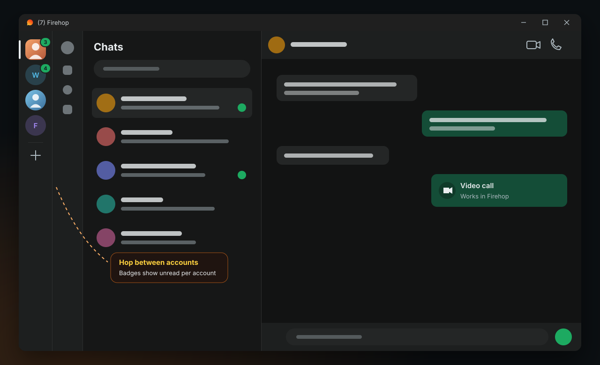
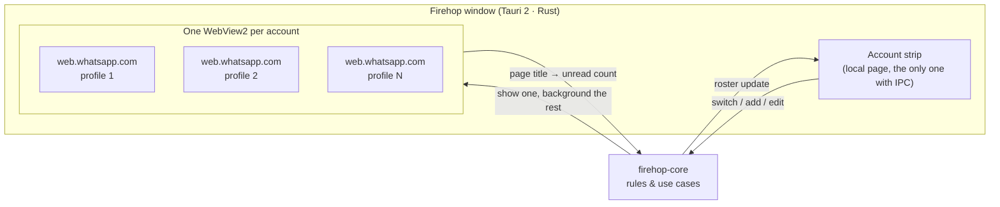

<div align="center">


<br />

**Firehop** puts all your WhatsApp accounts in one native desktop window.<br />
Each one runs the genuine WhatsApp Web in its own isolated profile. A slim strip on the left lets you hop between them.

<br />

[](https://github.com/msgadi/firehop/actions/workflows/ci.yml)


[](LICENSE)
[](https://github.com/msgadi/firehop/releases/latest)


**[⬇️ Download for Windows](https://github.com/msgadi/firehop/releases/latest)**

[Features](#-features) · [How it works](#-how-it-works) · [Download](#%EF%B8%8F-download) · [Build](#-build-from-source) · [Architecture](#%EF%B8%8F-architecture) · [FAQ](#-faq) · [Disclaimer](#%EF%B8%8F-disclaimer)

</div>

> [!WARNING]
> **Unofficial project.** Firehop is not affiliated with, authorised, maintained, sponsored or endorsed by WhatsApp LLC or Meta Platforms, Inc. WhatsApp does not endorse third-party clients, and **WhatsApp may restrict or ban accounts** that use them. You use Firehop at your own risk. [Read the full disclaimer.](#%EF%B8%8F-disclaimer)

<br />

<div align="center">
  
  <sub>Illustration. Inside Firehop you see the real WhatsApp Web, exactly as WhatsApp ships it.</sub>
</div>

## 🔥 Why Firehop

You have a personal number, a work number, maybe a business line. The official
desktop app holds one at a time. Browser tabs share one login and forget which is which.

Firehop gives every number its own isolated session and keeps them all
connected, so messages, notifications and calls arrive for every account at
once. Switching between them is one click.

## ✨ Features

| | |
|---|---|
| 🧑‍🤝‍🧑 **Up to 10 accounts** | Each one is a completely isolated browser profile: separate login, storage and service workers. |
| 🎯 **Pixel-identical WhatsApp** | Firehop loads the genuine `web.whatsapp.com`. Nothing is restyled, injected or scraped, so every WhatsApp update shows up instantly. |
| 📞 **Voice & video calls** | Uses WhatsApp Web's own browser calling. Microphone and camera permission are handled for you. |
| 🔴 **Unread badges** | A live count on every account, plus the total in the window title and taskbar. |
| 🎨 **Make it yours** | Give each account a photo, a name, a full name and a colour. Right-click → *Edit account…* |
| ↕️ **Your order** | Drag accounts to rearrange the strip (or Alt+↑/↓). The order sticks, and Ctrl+1…9 follow it. |
| 🪶 **Light on memory** | Hidden accounts stay connected but drop to WebView2's low-memory mode, using the same tuning flags as WhatsApp's own Windows client. |
| 🛡️ **Locked down** | WhatsApp pages get no access to the app. Foreign links open in your browser, and custom URL schemes are blocked. |
| 🔥 **Stays in the tray** | Closing the window keeps Firehop running in the tray, so messages and calls still arrive. Quit from the tray icon. |
| 🧈 **Smooth** | Native Rust shell, no Electron. Keyed DOM updates, compositor-only animations, no white flashes. |

## 🧭 How it works

The official WhatsApp Desktop for Windows is itself WhatsApp Web inside
Microsoft WebView2 ([teardown](docs/research/whatsapp-desktop-teardown.md)).
Firehop uses that same engine, once per account:



- **Isolation:** every account gets its own WebView2 user-data folder, as if each had its own browser.
- **Unread counts** come from the page title ("(3) WhatsApp"). That is the only signal we read from WhatsApp's page.
- **Switching** shows the target before hiding the rest, so there is never an empty frame.

## ⬇️ Download

1. Get **`Firehop_x.y.z_x64-setup.exe`** from the [latest release](https://github.com/msgadi/firehop/releases/latest) (about 2 MB, Windows 10/11, no admin rights needed).
2. Run it. The installer is not code-signed yet, so Windows SmartScreen may say *"Windows protected your PC"*. Click **More info → Run anyway**.
3. Click **+** in the strip and scan the QR code with WhatsApp on your phone (*Settings → Linked devices → Link a device*). Repeat for every number.

## 🚀 Build from source

**Prerequisites:** [Rust](https://rustup.rs) (stable), [Node.js 24](https://nodejs.org), and the WebView2 runtime (already on Windows 10/11).

```sh
git clone https://github.com/msgadi/firehop.git
cd firehop
npm install
npm run dev      # run with hot reload
npm run build    # optimised build + NSIS installer
```

Then click **+** in the strip and scan the QR code with WhatsApp on your phone
(*Settings → Linked devices → Link a device*). Repeat for every number.

## 🏛️ Architecture

Clean and hexagonal: business rules know nothing about Tauri, and the crate
boundary makes the compiler enforce it.

```
crates/core      firehop-core: domain, use cases, ports, policies (no UI framework)
src-tauri        Tauri shell: window, webviews, WebView2 glue, IPC commands
ui               account strip + account editor (strict TypeScript, no framework)
docs             architecture, decision records, research
```

Read [docs/architecture.md](docs/architecture.md) for the full picture and
[docs/decisions](docs/decisions) for why things are the way they are.

## ❓ FAQ

<details>
<summary><b>Will my account get banned?</b></summary>
<br />
Firehop shows the same WhatsApp Web you would open in Edge or Chrome, with no
automation, no injected scripts and no modified traffic. That is far from what
bots and modded clients do. But WhatsApp does not endorse third-party clients
and can restrict any account at its discretion. <b>We cannot promise your
account is safe.</b> If that risk is not acceptable, use the official apps.
</details>

<details>
<summary><b>Are my messages private?</b></summary>
<br />
Yes. Firehop has no servers, no analytics and no telemetry. Everything stays in
WhatsApp's own end-to-end encrypted web client and in local profile folders on
your PC.
</details>

<details>
<summary><b>Do calls work?</b></summary>
<br />
Yes, through WhatsApp Web's browser calling (rolled out from July 2026).
Availability depends on WhatsApp's rollout for your account.
</details>

<details>
<summary><b>macOS or Linux?</b></summary>
<br />
Windows first. The core is cross-platform and Tauri supports both, so
contributions are welcome.
</details>

<details>
<summary><b>How do I log an account out?</b></summary>
<br />
Right-click it in the strip → <i>Log out and remove…</i>. This erases its
local profile. You can also remove the linked device from your phone.
</details>

## 🤝 Contributing

Issues and pull requests are welcome. Start with [CONTRIBUTING.md](CONTRIBUTING.md) and [AGENTS.md](AGENTS.md) (the project rulebook, for humans and AI agents alike).
Security issues: please follow [SECURITY.md](SECURITY.md) instead of opening a public issue.

## ⚠️ Disclaimer

- Firehop is an **independent, unofficial** open-source project. It is **not affiliated with, authorised, maintained, sponsored or endorsed by WhatsApp LLC, Meta Platforms, Inc.** or any of their affiliates.
- "WhatsApp" is a trademark of WhatsApp LLC. It is used here only to describe what Firehop works with. Firehop ships none of WhatsApp's code, logos or assets.
- WhatsApp **does not permit unofficial clients** in its Terms of Service and **may restrict or permanently ban accounts** that use them. Firehop only displays the official WhatsApp Web, but that does not guarantee your account will not be affected.
- **Use at your own risk.** The software is provided "as is", without warranty of any kind. The authors are not liable for banned or restricted accounts, lost data or any other damage (see [LICENSE](LICENSE)).
- Do not use Firehop for spam, bulk messaging or anything else that breaks WhatsApp's terms or the law.

<div align="center">
<br />
<sub>Made with 🔥 by <a href="https://github.com/msgadi">@msgadi</a></sub>
</div>
